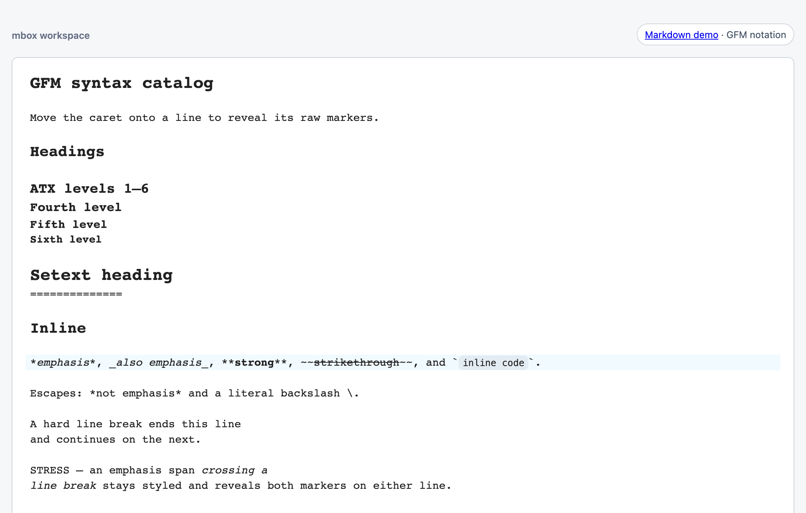

# mbox

A structured text editor built on [CodeMirror 6](https://codemirror.net/). Only the focused line shows its raw syntax; every other line has its syntax hidden or replaced with a rendered representation, so the document always reads close to its finished form while you edit.

The four notations that ship — mbox's own, GFM, Scrapbox, Hatena — are each just a list of `MboxPlugin`s. Yours would be too.



**Live demo:** [mbox notation](https://synpuls.github.io/mbox/) · [GFM](https://synpuls.github.io/mbox/demos/gfm.html) · [Scrapbox](https://synpuls.github.io/mbox/demos/scrapbox.html) · [Hatena](https://synpuls.github.io/mbox/demos/hatena.html)

> **Status:** pre-1.0. The package's exports are supported API, but they may still change before the 1.0 release.

## Install

```
npm install @synpuls/mbox
```

CodeMirror packages are peer dependencies, installed automatically by npm 7+ / Yarn / pnpm. ESM-only; the editor needs the DOM, so in SSR frameworks construct it client-side.

## Quick start

```ts
import { createGfmEditor } from "@synpuls/mbox/gfm";

createGfmEditor({
  parent: document.querySelector("#editor")!,
  doc: "# Hello\n\nSome **GFM** text.",
});
```

Each notation lives at its own sub-path with the same API:

```ts
import { createGfmEditor } from "@synpuls/mbox/gfm";           // GitHub Flavored Markdown
import { createScrapboxEditor } from "@synpuls/mbox/scrapbox"; // Scrapbox notation
import { createHatenaEditor } from "@synpuls/mbox/hatena";     // Hatena notation
import { createMboxEditor } from "@synpuls/mbox";             // mbox's own notation
```

## Going further

The [guide](./docs/guide.md) covers the rest of the public API:

- Reacting to edits, React integration, and passing your own CodeMirror `extensions`
- `readOnly: true` — a non-editing, always-rendered display mode, not a security boundary for untrusted input
- Writing plugins and whole notations, and testing them with `@synpuls/mbox/testing`
- Styling: default presentation themes, `.mbox-*` class names, CSS variables
- What counts as supported API, and troubleshooting

For working on mbox itself, see [CONTRIBUTING.md](https://github.com/synpuls/mbox/blob/main/CONTRIBUTING.md) and [TESTING.md](https://github.com/synpuls/mbox/blob/main/TESTING.md).

## Untrusted content

mbox parses and renders structured text, but hosts are responsible for the
resource and navigation policies used when displaying untrusted documents. It
provides no input-size, CPU, or interruption limits, and its document cache
reparses the full document on every edit; apply limits before fetching,
decoding, pasting, or programmatic updates.

`image: { renderMode: "preview" }` loads document-specified image URLs. Use
the default `"token"` mode when external image loading is not intended, and
apply your own URL, network, CSP, and privacy policies. GFM links, including
`linkUrl` results, are allowlist-checked; image URLs and host resolver results
remain the host's responsibility. Prefer an explicit `codeHighlight: {
languages: [...] }` allowlist over `languages: "all"`.

See [SECURITY.md](https://github.com/synpuls/mbox/blob/main/SECURITY.md#untrusted-content) for the full guidance.

## License

[MIT](./LICENSE)
